# Monitorización de sistemas Linux

Práctica de monitorización en Ubuntu Linux: uso de las principales herramientas para observar procesos, CPU, memoria, almacenamiento, red, puertos y conexiones.

- **Autor:** _(tu nombre)_
- **Sistema:** Ubuntu Linux (máquina virtual)
- **Fecha:** _(fecha)_

## Índice

1. [Preparación del entorno](#1-preparación-del-entorno)
2. [Procesos y CPU](#2-procesos-y-cpu): ps, top, htop, atop
3. [Memoria RAM](#3-memoria-ram): free
4. [Almacenamiento](#4-almacenamiento): df, du, iostat
5. [Tráfico de red](#5-tráfico-de-red): tcpdump, tcptrack, iptraf-ng, bmon
6. [Puertos y conexiones](#6-puertos-y-conexiones): ss, nmap
7. [Análisis de resultados](#7-análisis-de-resultados)

---

## 1. Preparación del entorno

Actualizamos los índices de paquetes e instalamos las herramientas que no vienen por defecto en Ubuntu:

```bash
sudo apt update
sudo apt install -y htop atop sysstat tcpdump tcptrack iptraf-ng bmon nmap
```

| Paquete | Aporta |
|---|---|
| `htop` | htop |
| `atop` | atop |
| `sysstat` | iostat (además de sar, mpstat, etc.) |
| `tcpdump`, `tcptrack`, `iptraf-ng`, `bmon` | herramientas de tráfico de red |
| `nmap` | escáner de puertos |

`ps`, `top`, `free`, `df`, `du` y `ss` forman parte de los paquetes base (`procps`, `coreutils`, `iproute2`) y ya vienen instalados.

---

## 2. Procesos y CPU

### 2.1 `ps`

**Finalidad:** muestra una *instantánea* de los procesos en ejecución en el momento de lanzar el comando: PID, usuario propietario, consumo de CPU y memoria, estado y comando que lo lanzó.

**Sintaxis:**

```bash
ps [opciones]
```

| Opción | Descripción |
|---|---|
| `aux` | Todos los procesos de todos los usuarios, con formato detallado (usuario, %CPU, %MEM...) |
| `-ef` | Listado completo en formato estándar, incluye el PPID (proceso padre) |
| `--sort=-%mem` | Ordena de mayor a menor consumo de memoria |
| `-u usuario` | Procesos de un usuario concreto |

**Ejecución:**

```bash
ps aux
ps aux --sort=-%mem | head -n 10
```

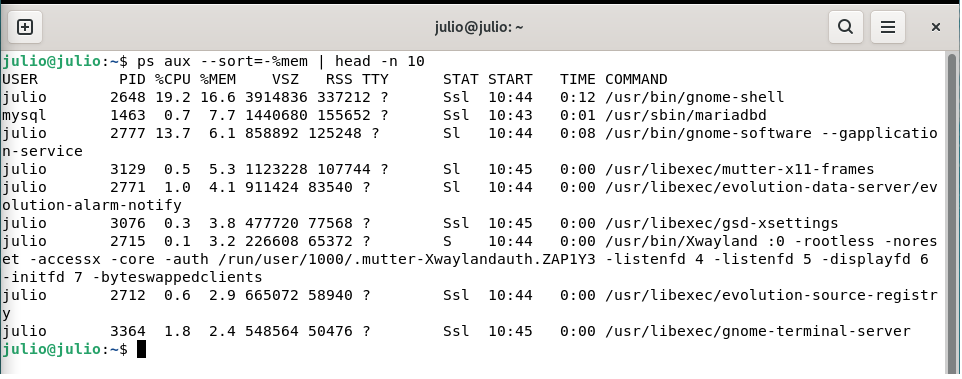

**Interpretación:** columnas principales: `USER` (propietario), `PID`, `%CPU`, `%MEM`, `VSZ`/`RSS` (memoria virtual y residente), `STAT` (estado: `R` en ejecución, `S` dormido, `Z` zombi, `D` espera de E/S) y `COMMAND`. Un administrador lo usa para localizar procesos que consumen muchos recursos, encontrar procesos zombi o obtener el PID de un proceso para terminarlo con `kill`.

### 2.2 `top`

**Finalidad:** monitoriza los procesos **en tiempo real**, con un resumen del sistema (carga, CPU, memoria) y la lista de procesos ordenada por consumo.

**Sintaxis:**

```bash
top [opciones]
```

| Opción / tecla | Descripción |
|---|---|
| `-d segundos` | Intervalo de actualización |
| `-u usuario` | Muestra solo los procesos de un usuario |
| `-p PID` | Monitoriza un proceso concreto |
| Tecla `M` / `P` | Ordena por memoria / por CPU |
| Tecla `k` | Envía una señal (matar) a un proceso |
| Tecla `q` | Salir |

**Ejecución:**

```bash
top
```

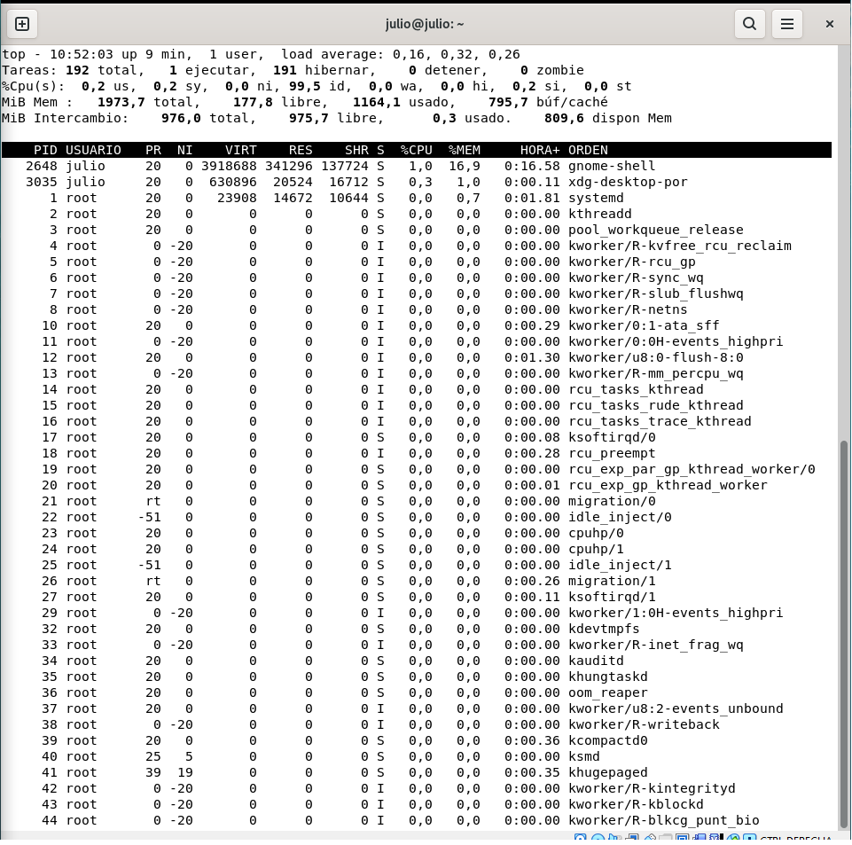

**Interpretación:** la cabecera indica el tiempo de actividad y la *load average* (carga media en 1, 5 y 15 minutos), el número de tareas por estado, el reparto de CPU (`us` usuario, `sy` sistema, `id` inactiva, `wa` espera de E/S) y el uso de RAM y swap. Un `wa` alto sugiere problemas de disco; una carga media superior al número de núcleos indica saturación de CPU.

### 2.3 `htop`

**Finalidad:** versión mejorada e interactiva de `top`, con colores, barras gráficas por núcleo, desplazamiento y manejo con teclado o ratón.

**Instalación:**

```bash
sudo apt install htop
```

**Sintaxis:**

```bash
htop [opciones]
```

| Opción / tecla | Descripción |
|---|---|
| `-u usuario` | Filtra por usuario |
| `-d décimas` | Intervalo de refresco (en décimas de segundo) |
| `F5` | Vista de árbol de procesos |
| `F6` | Elegir la columna de ordenación |
| `F9` | Matar un proceso |

**Ejecución:**

```bash
htop
```

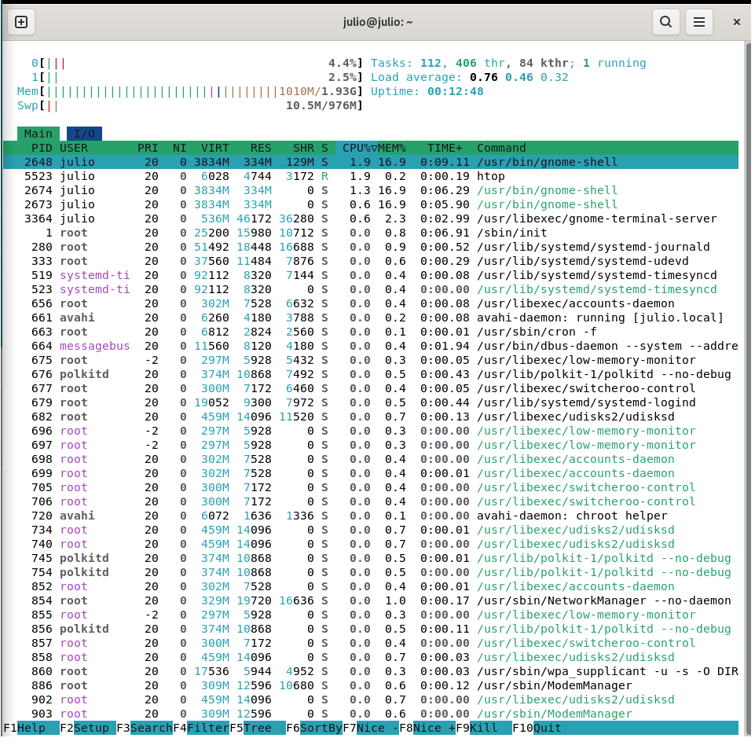

**Interpretación:** en la parte superior se ven barras con el uso de cada núcleo de CPU, la memoria y el swap. Debajo, la tabla de procesos con prioridad (`PRI`, `NI`), memoria, CPU y tiempo. Es más cómodo que `top` para localizar y terminar procesos problemáticos y para ver la relación padre-hijo en modo árbol.

### 2.4 `atop`

**Finalidad:** monitor avanzado que muestra CPU, memoria, disco y red, y además puede **registrar el histórico** en un fichero para analizar problemas ocurridos en el pasado.

**Instalación:**

```bash
sudo apt install atop
```

**Sintaxis:**

```bash
atop [opciones] [intervalo]
```

| Opción / tecla | Descripción |
|---|---|
| `intervalo` | Segundos entre actualizaciones (ej. `atop 2`) |
| `-r fichero` | Reproduce un fichero de registro guardado |
| `-w fichero` | Guarda el registro en un fichero |
| Tecla `d` / `m` / `n` | Ordena por uso de disco / memoria / red |

**Ejecución:**

```bash
sudo atop
```

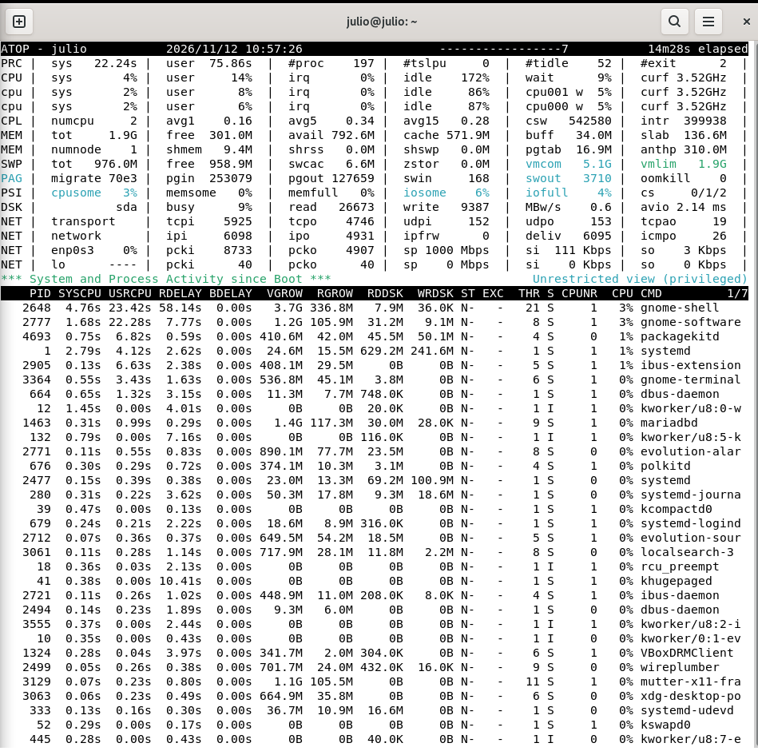

**Interpretación:** la parte superior resume recursos del sistema (`PRC`, `CPU`, `MEM`, `DSK`, `NET`). Las líneas en rojo indican recursos críticos o saturados. Resulta muy útil para saber qué proceso provocó una sobrecarga a una hora concreta, gracias a los registros históricos.

---

## 3. Memoria RAM

### 3.1 `free`

**Finalidad:** muestra la cantidad de memoria RAM y swap total, usada y libre del sistema.

**Sintaxis:**

```bash
free [opciones]
```

| Opción | Descripción |
|---|---|
| `-h` | Formato legible (KiB, MiB, GiB) |
| `-m` | Muestra los valores en MiB |
| `-s n` | Actualiza cada *n* segundos |
| `-t` | Añade una fila con el total (RAM + swap) |

**Ejecución:**

```bash
free -h
```

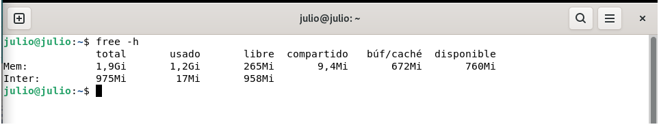

**Interpretación:** columnas: `total` (memoria instalada), `used` (en uso), `free` (sin usar), `shared`, `buff/cache` (usada como caché de disco, recuperable) y **`available`** (memoria realmente disponible para nuevas aplicaciones). El dato clave es `available`, no `free`. Si `available` es muy bajo y el swap se usa mucho, el servidor necesita más RAM o hay un proceso con fuga de memoria.

---

## 4. Almacenamiento

### 4.1 `df`

**Finalidad:** informa del espacio total, usado y libre en cada **sistema de ficheros montado** (a nivel de partición).

**Sintaxis:**

```bash
df [opciones] [ruta]
```

| Opción | Descripción |
|---|---|
| `-h` | Tamaños legibles (GB, MB) |
| `-T` | Muestra el tipo de sistema de ficheros |
| `-i` | Muestra el uso de inodos en lugar de bloques |

**Ejecución:**

```bash
df -hT
```

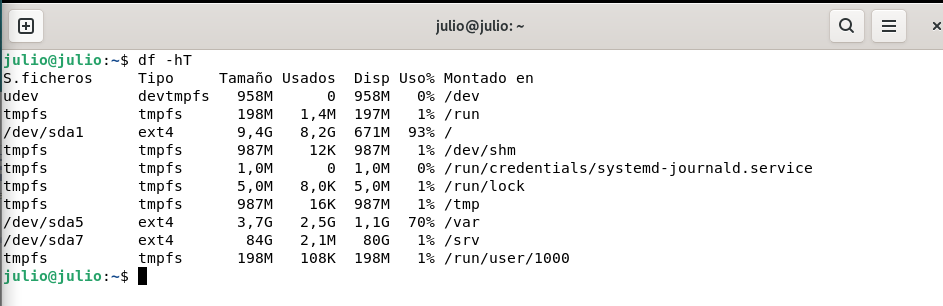

**Interpretación:** para cada partición se ve el tamaño, lo usado, lo disponible, el porcentaje `Use%` y el punto de montaje. Un `Use%` cercano al 100 % en `/` o `/var` es una alerta: el servidor puede dejar de funcionar al no poder escribir logs o datos.

### 4.2 `du`

**Finalidad:** calcula el espacio que ocupan **ficheros y directorios** concretos. Sirve para descubrir qué está llenando el disco.

**Sintaxis:**

```bash
du [opciones] [ruta]
```

| Opción | Descripción |
|---|---|
| `-h` | Tamaños legibles |
| `-s` | Muestra solo el total de cada argumento (resumen) |
| `--max-depth=N` | Limita la profundidad de directorios mostrados |
| `-a` | Incluye también los ficheros, no solo directorios |

**Ejecución:**

```bash
sudo du -h --max-depth=1 /var | sort -hr | head
```

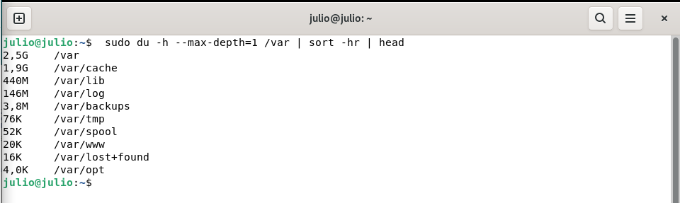

**Interpretación:** muestra el tamaño de cada subdirectorio. Combinado con `sort -hr` se obtienen los directorios más pesados. Se usa tras detectar con `df` que una partición está llena, para encontrar la carpeta o el fichero responsable (por ejemplo, logs en `/var/log`).

### 4.3 `iostat`

**Finalidad:** muestra estadísticas de uso de CPU y de **entrada/salida de los dispositivos de disco** (lecturas, escrituras, tiempos de espera y saturación).

**Instalación:**

```bash
sudo apt install sysstat
```

**Sintaxis:**

```bash
iostat [opciones] [intervalo] [repeticiones]
```

| Opción | Descripción |
|---|---|
| `-x` | Estadísticas extendidas (latencias, utilización) |
| `-h` | Formato legible |
| `-d` | Solo informe de dispositivos |
| `intervalo repeticiones` | Ej. `iostat -x 2 5`: cada 2 s, 5 veces |

**Ejecución:**

```bash
iostat -x 2 5
```

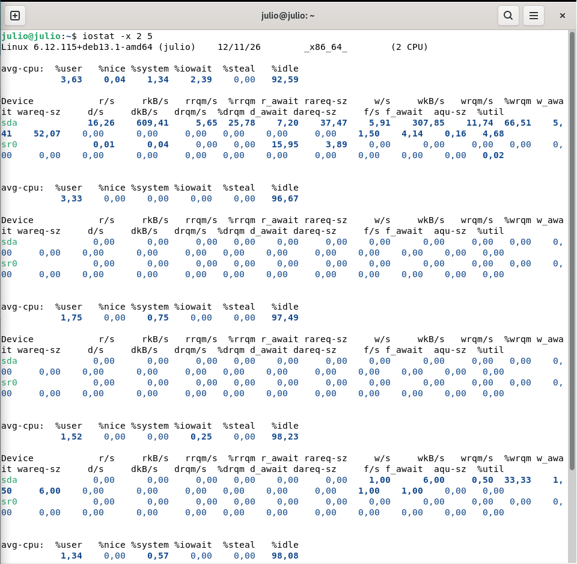

**Interpretación:** campos importantes: `r/s` y `w/s` (operaciones por segundo), `rkB/s` y `wkB/s` (rendimiento), `await` (tiempo medio de espera por operación) y `%util` (porcentaje de tiempo que el disco está ocupado). Un `%util` próximo al 100 % junto con un `await` alto indica un cuello de botella en el disco.

---

## 5. Tráfico de red

### 5.1 `tcpdump`

**Finalidad:** analizador de paquetes por línea de comandos. Captura y muestra el tráfico que pasa por una interfaz de red.

**Sintaxis:**

```bash
sudo tcpdump [opciones] [filtro]
```

| Opción | Descripción |
|---|---|
| `-i interfaz` | Interfaz a escuchar (`any` para todas) |
| `-n` | No resuelve nombres (más rápido, muestra IPs) |
| `-c N` | Captura solo N paquetes |
| `-w fichero.pcap` | Guarda la captura para analizarla después (p. ej. con Wireshark) |
| `port 80`, `host 1.2.3.4` | Filtros por puerto o dirección |

**Ejecución:**

```bash
ip a                                  # ver el nombre de la interfaz
sudo tcpdump -i enp0s3 -n -c 20
sudo tcpdump -i enp0s3 -n port 80 -c 10
```

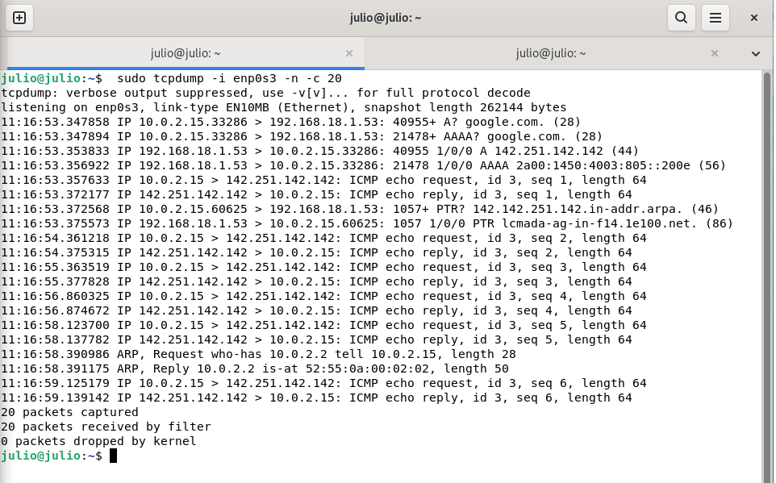

**Interpretación:** cada línea muestra la hora, el protocolo, origen y destino (IP.puerto), los flags TCP (`S` SYN, `.` ACK, `F` FIN, `P` PSH) y la longitud. Permite diagnosticar problemas de conectividad, ver qué equipos se comunican con el servidor y detectar tráfico sospechoso.

### 5.2 `tcptrack`

**Finalidad:** muestra en tiempo real las **conexiones TCP activas** en una interfaz, con la velocidad de cada una.

**Instalación:**

```bash
sudo apt install tcptrack
```

**Sintaxis:**

```bash
sudo tcptrack -i interfaz [filtro]
```

| Opción | Descripción |
|---|---|
| `-i interfaz` | Interfaz a monitorizar |
| `-d` | Muestra solo las conexiones activas con tráfico |
| `-r segundos` | Intervalo de refresco |
| `port 22` | Filtro de tipo tcpdump (por puerto, host...) |

**Ejecución:**

```bash
sudo tcptrack -i enp0s3
```

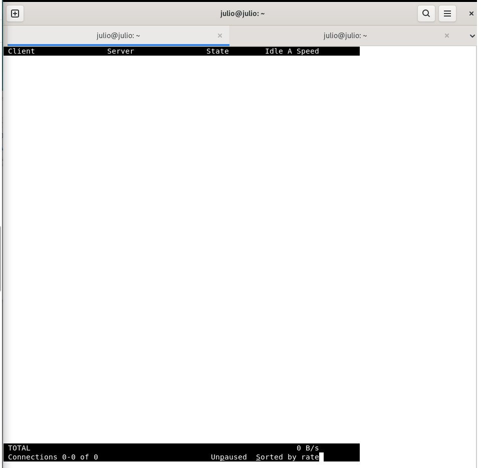

**Interpretación:** lista cada conexión (origen, destino, estado) y su velocidad de transferencia actual. Útil para saber qué conexión está consumiendo ancho de banda.

### 5.3 `iptraf-ng`

**Finalidad:** monitor de red interactivo basado en menús: estadísticas de conexiones IP, tráfico por interfaz y por puerto.

**Instalación:**

```bash
sudo apt install iptraf-ng
```

**Sintaxis:**

```bash
sudo iptraf-ng [opciones]
```

| Opción | Descripción |
|---|---|
| `-i interfaz` | Monitoriza el tráfico IP de una interfaz |
| `-g` | Muestra las estadísticas generales de todas las interfaces |
| `-d interfaz` | Estadísticas detalladas de una interfaz |
| `-s interfaz` | Estadísticas por puertos TCP/UDP |

**Ejecución:**

```bash
sudo iptraf-ng
```

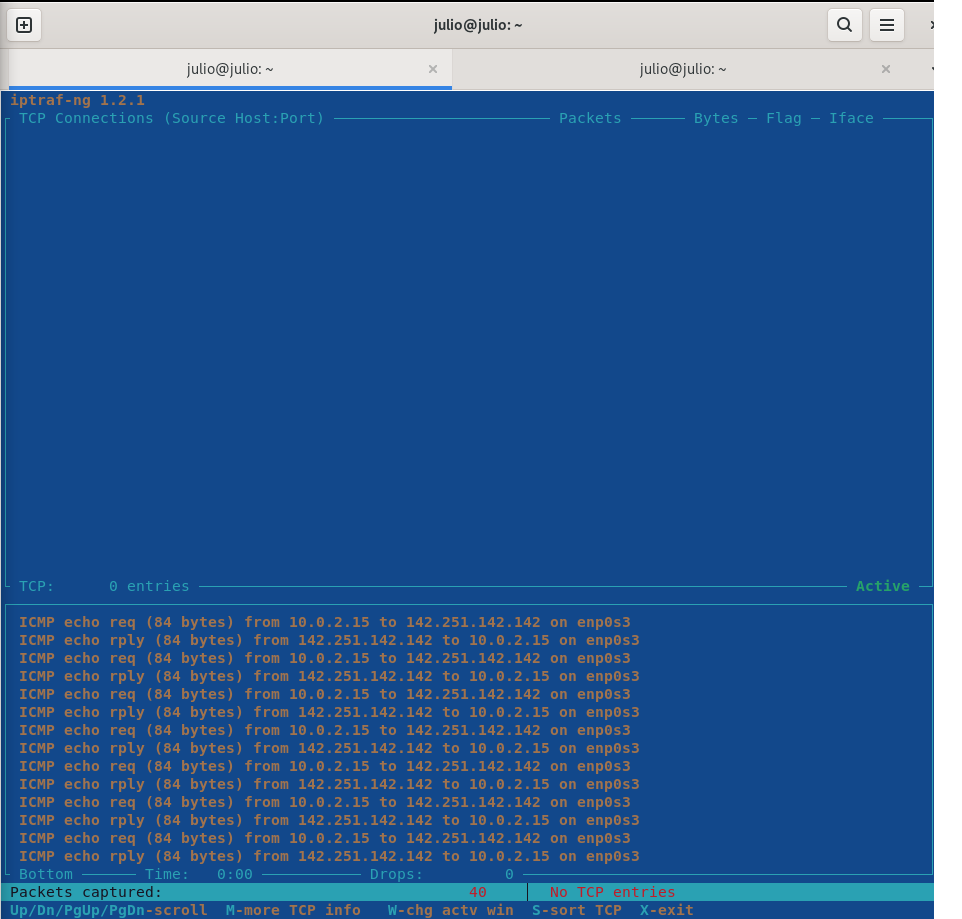

**Interpretación:** muestra las conexiones activas con direcciones, puertos, paquetes y bytes transferidos. Permite ver qué servicios o puertos generan más tráfico y comparar el tráfico de entrada y salida.

### 5.4 `bmon`

**Finalidad:** monitor de ancho de banda que muestra gráficamente el tráfico de entrada y salida de cada interfaz.

**Instalación:**

```bash
sudo apt install bmon
```

**Sintaxis:**

```bash
bmon [opciones]
```

| Opción | Descripción |
|---|---|
| `-p interfaz` | Limita la vista a la(s) interfaz indicada(s) |
| `-r segundos` | Intervalo de refresco |
| `-o formato` | Formato de salida (ej. `ascii`) |

**Ejecución:**

```bash
bmon
```

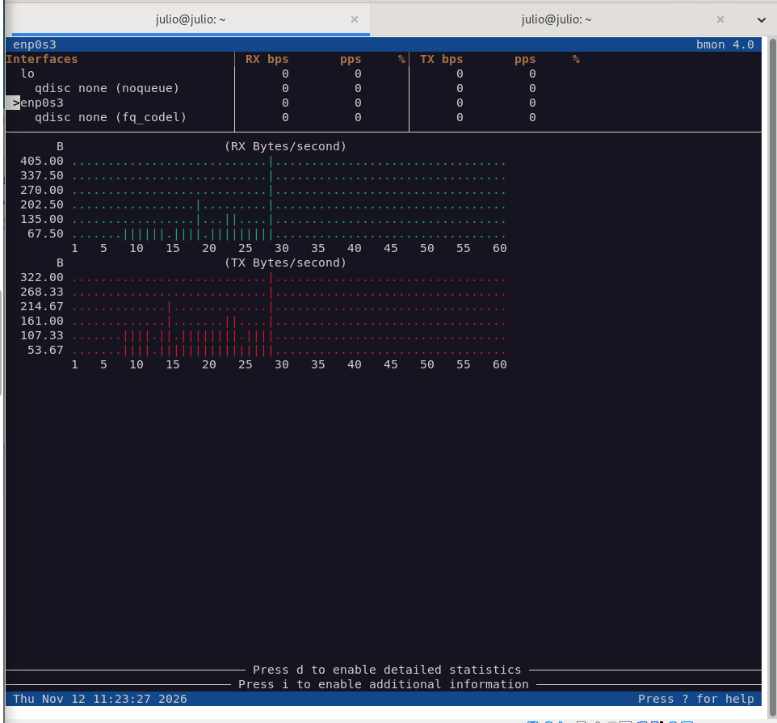

**Interpretación:** muestra los bytes/paquetes recibidos (`RX`) y transmitidos (`TX`) por segundo y un gráfico histórico. Sirve para detectar picos de tráfico, saturación del enlace o interfaces inactivas.

---

## 6. Puertos y conexiones

### 6.1 `ss`

**Finalidad:** muestra información sobre los **sockets** del sistema local: puertos en escucha y conexiones establecidas. Sustituye a `netstat`.

**Sintaxis:**

```bash
ss [opciones]
```

| Opción | Descripción |
|---|---|
| `-t` / `-u` | Sockets TCP / UDP |
| `-l` | Solo puertos en escucha (*listening*) |
| `-n` | Muestra puertos numéricos, sin resolver nombres |
| `-p` | Muestra el proceso asociado a cada socket (requiere `sudo`) |
| `-s` | Resumen estadístico |

**Ejecución:**

```bash
sudo ss -tulnp
ss -s
```

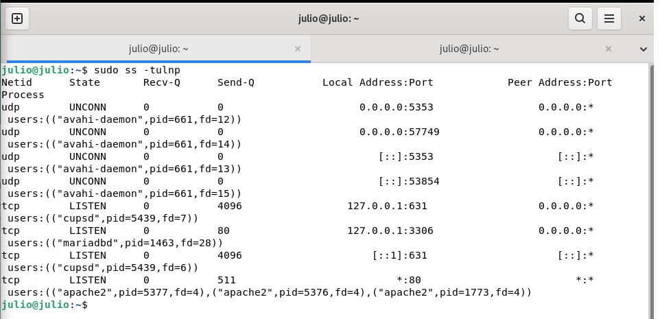

**Interpretación:** cada línea indica el protocolo, el estado (`LISTEN`, `ESTAB`...), la dirección local y el puerto, la dirección remota y el proceso. Permite saber qué servicios están escuchando en el propio equipo (ej. SSH en el 22, Apache en el 80) y detectar servicios no deseados.

### 6.2 `nmap`

**Finalidad:** escáner de red que descubre equipos y **puertos abiertos** accediendo desde fuera, y puede identificar servicios y versiones.

**Instalación:**

```bash
sudo apt install nmap
```

**Sintaxis:**

```bash
nmap [opciones] objetivo
```

| Opción | Descripción |
|---|---|
| `-p puertos` | Puertos a escanear (ej. `-p 22,80,443` o `-p-` para todos) |
| `-sV` | Detecta el servicio y su versión |
| `-sn` | Descubrimiento de equipos (sin escaneo de puertos) |
| `-A` | Escaneo agresivo (SO, versiones, scripts) |

**Ejecución:**

```bash
nmap localhost
nmap -sV -p 22,80,443 localhost
```

> **Aviso:** solo se debe escanear equipos propios o con autorización expresa. En esta práctica se escanea la propia máquina virtual.

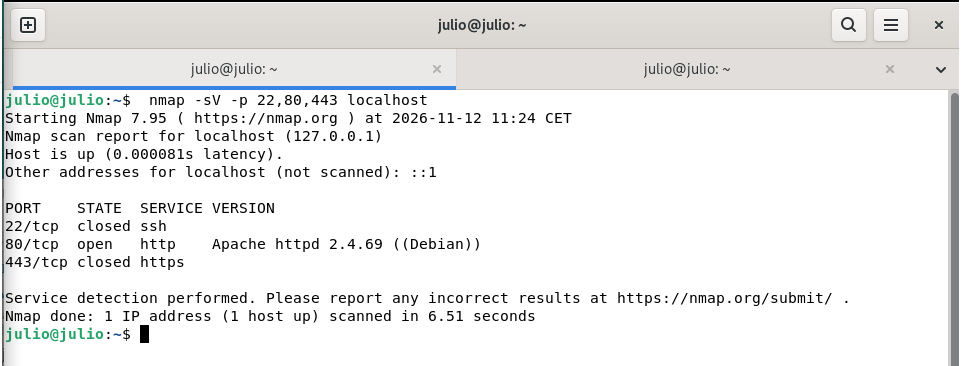

**Interpretación:** lista los puertos con su estado (`open`, `closed`, `filtered`) y el servicio asociado. Un administrador lo usa para auditar qué puertos están realmente expuestos y comprobar las reglas del cortafuegos.

---

## 7. Análisis de resultados

### 1. ¿Cómo comprobarías la cantidad de memoria RAM disponible?

Con el comando `free -h` y mirando la columna **`available`**, que indica la memoria que realmente pueden usar las aplicaciones (incluye la caché recuperable). También se puede ver en tiempo real con `top` o `htop`, o consultando `/proc/meminfo` (campo `MemAvailable`).

### 2. ¿Qué diferencia existe entre `df` y `du`?

- **`df`** informa del espacio a nivel de **sistema de ficheros/partición**: tamaño total, usado y libre de cada punto de montaje. Responde a "¿cuánto espacio queda en el disco?".
- **`du`** calcula el espacio que ocupan **ficheros y directorios** concretos. Responde a "¿qué está ocupando el espacio?".

Se usan juntos: `df` detecta que una partición está llena y `du` localiza dónde está el problema. Pueden dar cifras distintas, por ejemplo si un proceso mantiene abierto un fichero ya borrado.

### 3. ¿Qué diferencias existen entre `ss` y `nmap`?

| | `ss` | `nmap` |
|---|---|---|
| Ámbito | Equipo **local** | Equipo local o **remoto** (red) |
| Funcionamiento | Consulta los sockets del kernel | Envía paquetes de sondeo y analiza las respuestas |
| Información | Puertos en escucha, conexiones establecidas y proceso asociado | Puertos accesibles desde fuera, servicios y versiones |
| Uso típico | Administración y diagnóstico interno | Auditoría de seguridad y descubrimiento de red |
| Genera tráfico | No | Sí (puede ser detectado por un IDS) |

`ss` muestra lo que el servidor *tiene* abierto; `nmap` muestra lo que se *ve* desde fuera (teniendo en cuenta el cortafuegos).

### 4. ¿Cómo comprobarías si un servidor tiene abierto el puerto 80?

Desde el propio servidor:

```bash
sudo ss -tlnp | grep ':80'
```

Desde otro equipo (o localmente):

```bash
nmap -p 80 IP_DEL_SERVIDOR
```

Si el estado es `open`, el puerto está abierto. También se puede probar con `curl -I http://IP_DEL_SERVIDOR`.

### 5. ¿Qué herramienta utilizarías para detectar un posible cuello de botella en el disco?

**`iostat -x`**, observando `%util` (cercano al 100 % indica saturación) y `await` (latencia alta). Como apoyo, `top`/`htop` con un valor alto de `wa` (espera de E/S) y `atop`, que además identifica qué proceso genera la carga de disco.

### 6. ¿Por qué es importante monitorizar los recursos de un servidor?

- **Detectar problemas antes de que causen caídas:** discos llenos, memoria agotada o CPU saturada.
- **Rendimiento:** identificar cuellos de botella y procesos que consumen demasiado.
- **Planificación de capacidad:** conocer la tendencia de uso para ampliar recursos a tiempo.
- **Seguridad:** detectar tráfico inusual, puertos inesperados o procesos sospechosos.
- **Diagnóstico:** el histórico (p. ej. con `atop`) permite averiguar la causa de incidencias pasadas.
- **Disponibilidad y coste:** mantiene el servicio estable y evita gastos innecesarios por sobredimensionar.

---

## Estructura del repositorio

```
Monitorizacion/
│
├── README.md
│
└── capturas/
    ├── ps.png
    ├── top.png
    ├── htop.png
    ├── atop.png
    ├── free.png
    ├── df.png
    ├── du.png
    ├── iostat.png
    ├── tcpdump.png
    ├── tcptrack.png
    ├── iptraf.png
    ├── bmon.png
    ├── ss.png
    └── nmap.png
```
